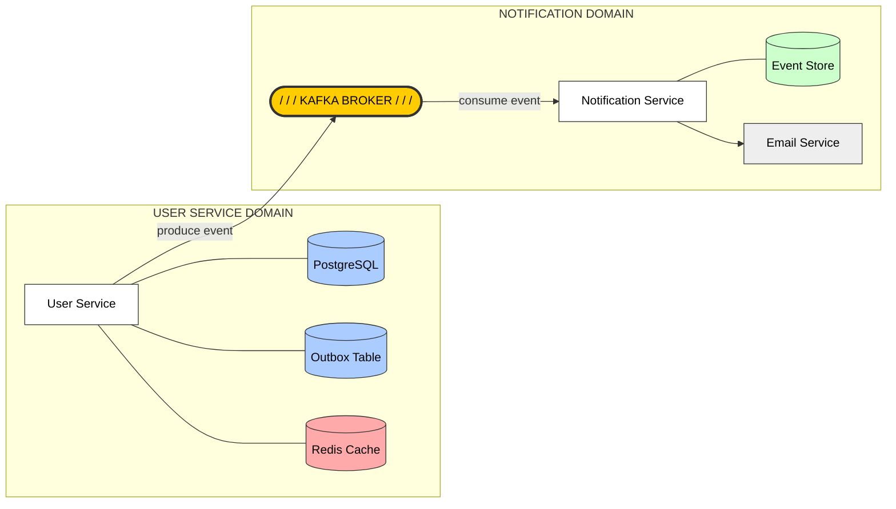
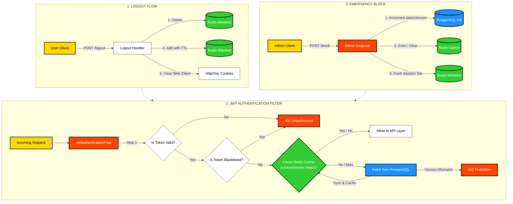

# 🚀 Multi-Module SpringBoot System
[](#)
[](#)

[](#)
[](#)
[](#)
[](#)


A robust, multi-module Spring Boot ecosystem designed for secure user authentication, profile management, and event-driven notifications.

---

## 🏗️ 0. System Architecture

The project is built on a **Modular Monolith/Microservices-ready** architecture, ensuring high decoupling and scalability.

*   **User Service:** The core business logic engine.
*   **Notify Service:** Asynchronous worker for external communications.
*   **Common:** Shared domain objects and utilities.
*   **Event-Driven:** Uses **Apache Kafka** with the **Transactional Outbox Pattern** to ensure data consistency between the database and message broker.
*   **Database Migrations:** Uses **Flyway** for reliable, automated, and version-controlled database schema management during application startup.

### Architecture Diagram


---

## 📦 1. Modules Breakdown

### 🔹 `user-service` (Primary Service)
The heart of the system, handling all user-related state changes.
*   **Authentication:** Secure Login, Logout, and Registration.
*   **Token Management:** Hybrid support for **HttpOnly Cookies** (Web) and **JWT Bearer Tokens** (Mobile).
*   **Authorization:** Role-Based Access Control (RBAC) with `ROLE_USER` and `ROLE_ADMIN`.
*   **Admin Domain:** Manage users (Delete, Block/Unblock, Role assignment).
*   **Persistence:** PostgreSQL with custom Global Exception Handling.

### 🔹 `notify-service` (Event Consumer)
An isolated service that reacts to system events.
*   **Kafka Integration:** Listens for events emitted by `user-service`.
*   **Features:** Triggers verification emails, password reset links, and security alerts based on event types.

### 🔹 `common` (Shared Library)
*   Centralized repository for DTOs, Constants, and Shared Models to ensure type safety across services.

---

## 🛠️ 2. Tech Stack


| Category | Technology |
| :--- | :--- |
| **Language** | Java 21 (LTS) |
| **Framework** | Spring Boot 3.1.x |
| **Security** | Spring Security & JWT |
| **Database** | PostgreSQL |
| **Database Migration** | Flyway |
| **Caching** | Redis (Token Revocation & Rate Limiting) |
| **Messaging** | Apache Kafka |
| **Build Tool** | Maven |

---

# 🚀 Getting Started

## 📋 Prerequisites

### Local Development Mode

Before you begin, ensure you have:
*   **JDK 21+** installed.
*   **Docker & Docker Compose** installed and running.
*   **IntelliJ IDEA** (Highly recommended for local development).
*   **Git Bash** (Required if you are on Windows and want to run the deployment `.sh` scripts).

> ✅ **Maven is NOT required.** The project includes the Maven Wrapper (`mvnw` / `mvnw.cmd`). You can build and run everything without installing Maven on your machine.

### Full Test Environment Deployment

Required:

- JDK 21+
- Maven
- Docker & Docker Compose
- Git Bash (Windows)

---

## 📥 Clone Repository

```bash
git clone https://github.com/your-org/your-repository.git
cd multiservice
```

---

# 🛠 Option 1: Local Development Setup

Recommended for active development and debugging.

## Step 1: Start Development Infrastructure

Start the required infrastructure services:

- PostgreSQL
- Kafka
- Kafka UI
- Other supporting services

```bash
cd docker/dev-infra

docker compose -f docker-compose-infra-dev.yaml up -d
```

Verify containers are running:

```bash
docker ps
```

---

## Step 2: Build the Project

From the project root directory:

```bash
# Windows
.\mvnw clean install -DskipTests

# Linux / macOS
./mvnw clean install -DskipTests
```

---

## Step 3: Run Application Services

### 🔹 Option A: IntelliJ IDEA (Recommended for Debugging)

Running from IntelliJ is the most reliable method, as it handles classpath resolution automatically and allows full debugging.

1. Open the project root in IntelliJ IDEA.
2. Ensure **JDK 21** is configured (`File > Project Structure > Project SDK`).
3. Wait for dependency download and indexing to finish.
4. **⚠️ IMPORTANT: Set the `dev` profile:**
   * Open your Run Configuration (top right).
   * In the **"Active profiles"** field (or VM options), type: `dev`
   * Click **Apply** and **OK**.
5. Locate the `UserServiceApplication` or `NotifyServiceApplication` class.
6. Click the green **Run** or **Debug** button.

### 🔹 Option B: Terminal (Using Executable JAR - Most Reliable)

If you prefer the terminal, or if you are on Windows with a project path containing non-ASCII characters (which breaks the `spring-boot:run` plugin), use the JAR method. This also ensures the `common` module is built first.

```bash
# 1. Build the whole multi-module project and install artifacts into the local Maven repository

.\mvnw clean install -DskipTests
```

```bash
# 2. Run the JAR with the dev profile
java -jar user-service/target/user-service-0.0.1-SNAPSHOT.jar --spring.profiles.active=dev
```

# 🧪 Option 2: Full Test Environment Deployment

Use this option when you want to run the complete test environment inside Docker.

The deployment includes:

- PostgreSQL
- Kafka
- Supporting infrastructure
- All Java microservices
- Test environment configuration


### Step 1: Create the Test Environment `.env`

The test environment requires its own `.env` file located inside the `docker/test-env/` directory. To prevent accidental commits of secrets, this file is **not** auto-generated by Git. You must create it manually from the example:

```bash
# Navigate to the test-env directory
cd docker/test-env

# Copy the example file (Linux/macOS/Git Bash)
cp .env.example .env

# Open .env and fill in required API keys (e.g., RESEND_API_KEY).
# Note: You can leave database passwords as their default values for local testing.
```
### Step 2: Run the Deployment Script

We have provided a bash script that handles the entire build and orchestration process.

> **⚠️ Windows Users:** You must run this script using **Git Bash** (not standard CMD or PowerShell), as it relies on bash syntax.

From the **project root**, run the script using `bash`:

```bash
bash docker/test-env/deploy-test-env.sh
```

### Step 3: Check if the Environment is Running

Once the script finishes and prints the green "✅ Test environment is up and running!" message, you can verify the status of the containers.

To see all running containers and their health status, run:
```bash
docker ps
```

---

# ⚙️ Environment Variables

The project uses the **dev** Spring profile for local development.

Custom configuration values (API keys, secrets, external URLs, etc.) are loaded from a local `.env` file located in the repository root.

Spring Boot automatically imports this file:

```yaml
spring:
  config:
    import: "file:../../.env[.properties]"
```

---

## Create Local `.env`

1. Locate `.env.example.dev` in the repository root.
2. Copy it:

```bash
cp .env.example.dev .env
```

3. Replace placeholder values with your local configuration.

---

> ⚠️ The `.env` file may contain sensitive information and must never be committed to source control.
>
> The file is already excluded through `.gitignore`.

## 📖 5. API Documentation & Testing

The system is fully documented using **OpenAPI 3 (Swagger)**.

*   **Interactive UI:** `http://localhost:8081/swagger-ui/index.html`
*   **JSON Definition:** `http://localhost:8081/v3/api-docs` (Import this link into **Postman** for a ready-to-use collection).

---
## 🔒 3. Session Lifecycle & Token Revocation Architecture

The system utilizes a multi-layered security verification strategy combining low-latency in-memory checks via Redis with absolute source-of-truth validation via PostgreSQL. This approach mitigates database bottleneck constraints during high-throughput API routing.

To achieve a stateless yet fully revocable authentication system, the architecture splits security responsibilities into three distinct mechanisms:

1. **Access Token Blacklist (Redis):** When a user logs out, their valid *Access Token* is added to a Redis Blacklist with a Time-To-Live (TTL) matching its remaining expiration time. The system rejects any request using a blacklisted token until it naturally expires.
2. **Refresh Token Whitelist (Redis):** *Refresh Tokens* are strictly tracked via a Redis Whitelist (stored as a Set per user). During logout or session invalidation, the token is permanently deleted from this set, immediately preventing the client from requesting new Access Tokens.
3. **Token Versioning (Redis Cache + PostgreSQL):** Every user profile contains a `tokenVersion` counter. 
   * When an *Access Token* is issued, the current version is embedded into its claims.
   * On every API request, the security filter extracts this version and compares it against the active `tokenVersion` stored in a fast-path **Redis Cache**.
   * If there is a **Cache Miss**, the system falls back to **PostgreSQL** to pull the absolute source of truth and repopulates the cache.
   * If an administrator triggers an emergency block, the `tokenVersion` is incremented in the DB, and the Redis cache is cleared. Instantly, all existing Access Tokens become invalid due to a version mismatch, enforcing a global session kill without performance degradation.
4. **Brute-Force & Rate Limiting Protection (Redis + Lua Scripting):** To defend against credential stuffing and brute-force attacks, the login pipeline evaluates request velocity *before* touching the database or verifying passwords.
   * **Atomic Verification:** The system executes an atomic **Lua script (`login_attempts.lua`)** directly inside Redis to check and increment the login attempts counter for the specific username.
   * **Sliding Window:** Upon the first failed or new attempt, a custom sliding window TTL is set. If the attempts counter crosses the `MAX_LOGIN_ATTEMPTS` threshold, the script deletes the counter, flags the user as locked (`lockeduserKey`), and sets a lockout lock time dynamically (e.g., 60 seconds).
   * **Early Fail-Fast:** If Redis returns `-1` (user is locked), the `user-service` short-circuits the pipeline immediately, throwing a `QApplicationException` mapped to a HTTP `429 Too Many Requests` state, safeguarding database resource pools from malicious stress.


